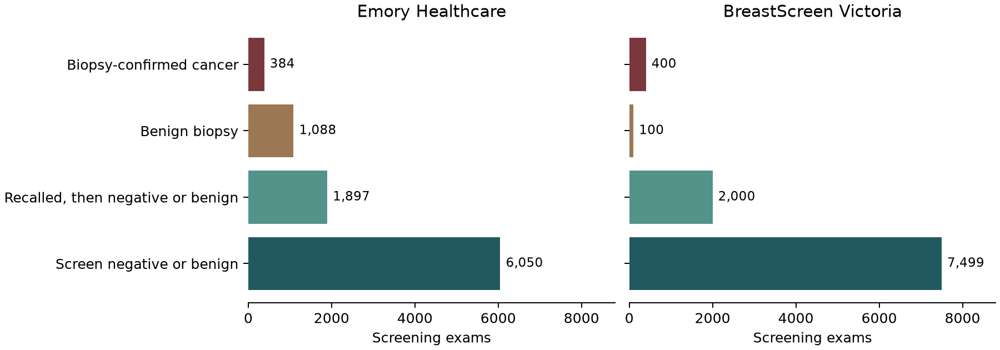
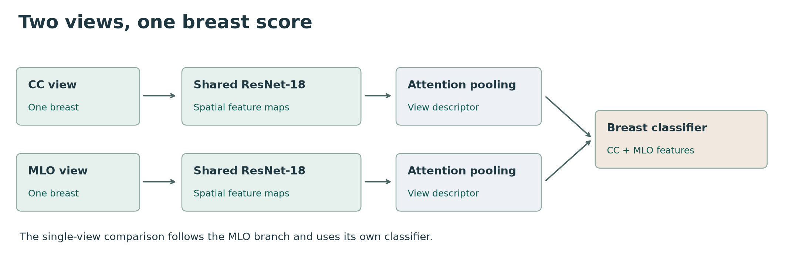

# Early Breast Cancer Detection on Screening Mammograms

Can a second mammographic view help distinguish a cancer-positive breast when the screening images come from a different hospital? This project compares an MLO-only model with a model that reads the standard CC and MLO views together. Both produce one score per breast.

**Study status.** The training and evaluation code runs end to end on generated DICOM fixtures. The Mac throughput benchmark and a chart of RSNA’s published cohort counts are available below. Patient-level training and independent-site performance measurements are pending access to the official images. **No clinical accuracy score has been measured for these models.**

## Why this dataset

The RSNA Screening Mammography Breast Cancer Detection Challenge drew 1,537 teams. The organizers describe 19,418 screening exams across the challenge, including 11,913 in the training partition. Positive cases have biopsy confirmation. Negative cases were checked through biopsy or follow-up. This study uses the **labeled training release** to create its own patient and site partitions. The actual number eligible for the paired comparison is calculated during preparation. [Dataset paper](https://pubs.rsna.org/doi/10.1148/ryai.250375) · [Official access](https://mira.rsna.org/dataset/3)

The chart reproduces Table 1 of the RSNA paper. The counts cover all challenge partitions. The two sites contributed different mixes of difficult and benign cases, which matters when interpreting precision. [Source counts](reports/published-cohort.csv) · [Figure script](scripts/plot_cohort.py)

## What early detection means here

The target is a cancer-positive breast **at the screening exam**. The label applies to the breast. The study can measure discrimination between positive and negative breasts. It cannot measure tumor stage, mark a lesion’s location, establish months of diagnostic lead time or demonstrate a patient benefit. RSNA excluded interval cancers. [Dataset design and limitations](https://pubs.rsna.org/doi/10.1148/ryai.250375)

## How the model reads a mammogram

The CC view looks down on the breast. MLO is an angled view. Both use the same feature extractor. A spatial attention layer pools each view’s features, and a small head combines the views in a fixed order. The single-view comparison uses the same MLO image, preprocessing, model family and training budget. Only the image pixels enter the network. [Model implementation](mammography/network.py)

## How the comparison works

| Group | What it controls |
| --- | --- |
| Emory training patients | Fit the model using breast-level cancer labels. |
| Separate Emory selection patients | Choose the epoch with the best average precision. |
| Separate Emory calibration patients | Calibrate scores and set a cutoff for at least 90% specificity on this group. |
| BreastScreen Victoria patients | Evaluate both models at the fixed cutoffs. |

Both breasts from one patient stay together. The primary comparison is the **difference in average precision** between the paired and single-view models. The report also gives ROC AUC, sensitivity, specificity, the fraction flagged and Brier score. Patient-level bootstrap intervals preserve the paired comparison. [Methods and limitations](METHODS.md)

## Install and run

The [setup guide](SETUP.md) covers Windows, macOS, Linux and an existing Kaggle workspace with the official competition data attached. The experiment has three steps: build the patient index, fit both models, and evaluate them on the held-out site. Each step has a command and expected output. The test suite can run without patient data.

## How long a run takes

On an Apple M1, a short benchmark at 768 × 512 pixels and batch size two measured **9.51 breasts/s** for MLO and **5.20 breasts/s** for CC + MLO. These are training steps on generated tensors already on the device. As an example, 10,000 training breasts × 10 epochs for each model projects to about **8.3 hours of model computation**. DICOM decoding, data transfer, validation and final evaluation add time. Substitute the actual training count from the cohort audit, then use the first real epoch in each model’s history to update the estimate. [Benchmark measurements](reports/hardware.json)

After a patient run, the evaluation command writes an aggregate metrics file and plots for precision–recall, ROC and calibration. Individual predictions, source images and model weights stay in the private run directory.
